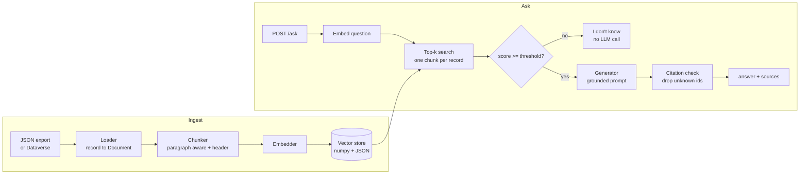

# crm-rag-agent

[](https://github.com/mateusmirandaia/crm-rag-agent/actions/workflows/ci.yml)

A retrieval-augmented agent that answers natural-language questions over CRM data
(accounts, support cases and knowledge articles) and cites the records it used.

## The problem

In most CRM deployments I have worked on, the answer to a support question already
exists somewhere: a resolved case from another customer, a knowledge article nobody
remembers, a note on the account. Finding it means knowing which entity to search,
which view to open and which keywords the last engineer happened to use.

This project puts a question-answering layer on top of that data with two hard rules:

1. **Every answer points back to records** a person can open and verify.
2. **When the data does not support an answer, it says "I don't know"** instead of
   producing something plausible.

The sample dataset in [`data/`](data/) is entirely fictional: ten invented accounts,
25 cases and ten knowledge articles for an invented IoT/field-service vendor. Any
resemblance to real companies is accidental.

## Architecture



| Module | Responsibility |
| --- | --- |
| `loaders.py` | Maps source records to `Document`. `JsonDirectoryLoader` for the sample, `DataverseLoader` stub for the real thing. |
| `chunking.py` | Paragraph/sentence chunking with overlap; every chunk is prefixed with the record title and a one-line header. |
| `providers/` | `Embedder` and `Generator` protocols. `local.py` (offline) and `azure_openai.py`. |
| `store.py` | Cosine search over a normalized matrix, persisted as `.npy` + JSON with a manifest. |
| `agent.py` | Retrieval, threshold, generation, citation validation. |
| `api.py` | FastAPI app: `/ask`, `/ingest`, `/health`. |
| `ingest.py` | CLI: `python -m crm_rag.ingest`. |

## Quickstart

### Local mode (no keys, no network)

```bash
pip install -e ".[dev]"
python -m crm_rag.ingest
uvicorn crm_rag.api:app --reload
```

Local mode uses hashing embeddings and an extractive generator that quotes the most
relevant sentences. It is there so the whole pipeline runs and is testable anywhere;
the answers are terse, but retrieval, thresholds and citations behave exactly as in
Azure mode.

### Azure OpenAI mode

```bash
cp .env.example .env
# set LLM_PROVIDER=azure, AZURE_OPENAI_ENDPOINT, AZURE_OPENAI_API_KEY and the deployment names
python -m crm_rag.ingest      # re-embeds everything with the Azure embedding deployment
uvicorn crm_rag.api:app
```

The index records which embedder built it. Starting the API with a different
embedder logs a warning and returns `503` on `/ask` until `/ingest` is called, rather
than silently comparing vectors from two different models.

### Docker

```bash
docker build -t crm-rag-agent .
docker run -p 8000:8000 crm-rag-agent
```

## API

```bash
curl -s localhost:8000/ask -H 'content-type: application/json' \
  -d '{"question": "Why did Velmora Freight trucks stop reporting after the firmware update?", "top_k": 3}'
```

```json
{
  "answer": "Gateways stopped reporting after firmware update [CAS-1001]: Problem: Around 200 trucks went silent overnight after the automatic update to firmware 4.2.0. All units reporting again within the hour. Velmora Freight [ACC-001]: Velmora Freight is a Strategic tier logistics account based in Rotterdam, Netherlands, using Gateway G2, Fleet Portal. ...",
  "sources": [
    {"id": "CAS-1001", "type": "case", "title": "Gateways stopped reporting after firmware update", "score": 0.4174},
    {"id": "ACC-001", "type": "account", "title": "Velmora Freight", "score": 0.2439}
  ],
  "grounded": true
}
```

An off-topic question:

```json
{"answer": "I don't know. The CRM records I can search do not cover this question.", "sources": [], "grounded": false}
```

| Endpoint | Purpose |
| --- | --- |
| `POST /ask` | `{question, top_k?}` to `{answer, sources[{id, type, title, score}], grounded}` |
| `POST /ingest` | Rebuild the index from `DATA_DIR` and hot-swap it |
| `GET /health` | Provider, whether an index is loaded, chunk count |

## Design decisions

**Why a score threshold, and why it lives on the embedder.** Top-k search always
returns k results, even for "what is the capital of France?". Without a floor, the
LLM gets five loosely related cases and is asked to make sense of them, which is
exactly when models invent answers. Below the threshold the agent returns "I don't
know" without calling the LLM at all: cheaper, faster and not dependent on the model
following instructions. Cosine scores are not comparable between embedding models
(hashing vectors score much lower than `text-embedding-3-small`), so each embedder
carries its own `default_min_score`, and `MIN_SCORE` overrides it once calibrated
with the eval script.

**Citations are validated, not trusted.** The prompt requires a `[RECORD-ID]` after
every factual sentence and an exact refusal phrase when the context is insufficient.
After generation the agent keeps only citations that match records actually sent in
the context; anything else is stripped. `sources` lists the cited records, so the
client can render links straight to the CRM form. `grounded: false` tells the client
the answer had no usable citation.

**Provider abstraction split into `Embedder` and `Generator`.** Embeddings and chat
fail, scale and cost differently, and in practice they are often mixed (local
embeddings with a hosted LLM, or a different embedding deployment per region).
Two small protocols keep that a configuration change. The offline provider is a real
implementation of the same protocols, which is what lets CI exercise the full path
with no secrets.

**Chunking follows the shape of CRM records.** Cases and articles are short and
already structured, so chunks split on paragraphs first, then sentences, with a
sentence-level overlap. Each chunk is prefixed with the record title and a header
(`Case for Velmora Freight about Gateway G2. Priority 1, status Resolved...`). Two
reasons: a chunk from the middle of an article still says what it is about, and the
account name ends up in the case text. Without that denormalization, "what issues did
Velmora have?" cannot match a case that only stores `account_id = ACC-001`.

**One chunk per record in the results.** Search over-fetches and keeps the best chunk
per record, so `top_k=5` means five different records. Otherwise a long article can
fill every slot with its own chunks and push out the case that actually answers.

**A numpy store instead of a vector database.** A CRM knowledge base of a few
thousand records is a matrix of a few megabytes; brute-force cosine takes well under a
millisecond. A database becomes worth it with filtering, incremental updates and
millions of chunks, which is why Azure AI Search is on the roadmap rather than in v1.

## Evaluation

[`eval/questions.jsonl`](eval/questions.jsonl) holds 18 answerable questions, each
with the record ids that would answer it, plus three deliberately off-topic ones.
[`eval/run_eval.py`](eval/run_eval.py) reports:

- **hit-rate@k**: share of answerable questions where at least one expected record
  is in the top k.
- **MRR@k**: how high the first correct record ranks.
- **refusal rate**: share of off-topic questions that get "I don't know".

```bash
python -m crm_rag.ingest
python eval/run_eval.py --k 5 -v
```

Results with the offline hashing embedder (default threshold 0.15):

| k | hit-rate | MRR | refusal rate |
| --- | --- | --- | --- |
| 1 | 0.89 | 0.89 | 0.67 |
| 3 | 1.00 | 0.94 | 0.67 |
| 5 | 1.00 | 0.94 | 0.67 |

The one off-topic question that slips through is "What is the capital of
Australia?": a lexical embedder sees "Australia" in a mining account and a case about
Perth time zones and scores them above the threshold. Raising the threshold to 0.20
fixes it on this set (`--min-score 0.20` gives a 1.00 refusal rate with no loss in
hit-rate), but it also starts refusing short, legitimate queries such as "sync
issues", so I kept 0.15. Semantic embeddings separate these cases much better, which
is the point of the Azure mode. CI runs the eval and fails below a 0.9 hit-rate or a
0.6 refusal rate, so a chunking or prompt change that hurts retrieval shows up in
the pull request.

With your own data, the useful loop is: write 30 to 50 real questions from support
tickets, run the eval across a few `--min-score` values, and pick the threshold where
refusals on off-topic questions stop improving faster than hit-rate drops.

## Configuration

All settings come from environment variables or `.env` (see
[`.env.example`](.env.example)); nothing secret is read from code.

| Variable | Default | Notes |
| --- | --- | --- |
| `LLM_PROVIDER` | `local` | `local` or `azure` |
| `AZURE_OPENAI_ENDPOINT` / `AZURE_OPENAI_API_KEY` | | required for `azure` |
| `AZURE_OPENAI_CHAT_DEPLOYMENT` | `gpt-4o-mini` | deployment name, not model name |
| `AZURE_OPENAI_EMBEDDING_DEPLOYMENT` | `text-embedding-3-small` | |
| `TOP_K` | `5` | default when the request omits it |
| `MIN_SCORE` | embedder default | 0.15 local, 0.30 Azure |
| `CHUNK_SIZE` / `CHUNK_OVERLAP` | `800` / `120` | characters |

## Development

```bash
pip install -e ".[dev]"
ruff check . && ruff format --check .
pytest
```

Tests run entirely in local mode and cover chunking, store ranking and persistence,
the threshold and "I don't know" path, citation filtering, and the API through
FastAPI's `TestClient`.

## Roadmap

- **Dataverse loader.** Implement `DataverseLoader` against the Web API with an app
  registration (MSAL client credentials), paging `accounts`, `incidents` and
  `knowledgearticles`, with incremental sync on `modifiedon`.
- **Hybrid search.** Combine BM25 with vectors (reciprocal rank fusion). CRM questions
  are full of exact tokens such as error codes, case numbers and product names, where
  keyword search beats embeddings.
- **Azure AI Search** as the store once the corpus outgrows memory, using its vector +
  keyword hybrid queries and security filters.
- **Record-level security.** Filter retrieval by the caller's Dataverse business unit
  and team access, so the agent never quotes a record the user could not open.
- **Answer-level eval.** Add faithfulness checks (does every cited sentence appear in
  the cited record?) alongside retrieval metrics.

## License

MIT
